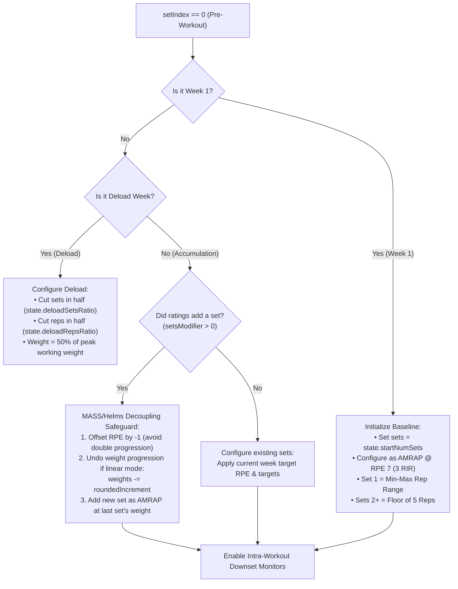
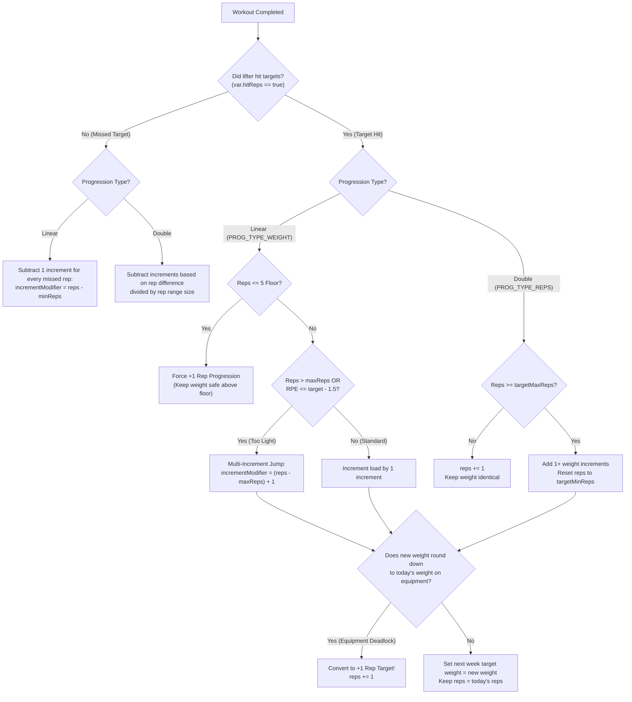

# Liftosaur RP Hypertrophy v4.1: Architecture & Technical Breakdown

> **Template Source:** [Liftosaur Blank Template (bd526c99)](https://www.liftosaur.com/p/bd526c99)  
> **Framework:** Liftoscript (Liftosaur's domain-specific scripting language)  
> **Underlying Philosophy:** Renaissance Periodization (RP) Hypertrophy Methodology + Eric Helms / MASS Fatigue Management Safeguards

---

## 1. Executive Summary & Purpose

The **RP Hypertrophy v4.1 Blank Template** on Liftosaur is a programmable strength and hypertrophy automation engine. It adapts the volume and proximity-to-failure principles pioneered by Renaissance Periodization (RP)—specifically matching/beating performance, rating-based volume autoregulation, and accumulation-to-deload transitions—while introducing algorithmic solutions to common RP software criticisms:

1. **Volume/Load Decoupling (The MASS / Eric Helms Safeguard):** Avoids simultaneously bumping volume (sets) and load (weight) in the same session.
2. **Equipment-Aware Plate Rounding Fallback:** Prevents progression deadlocks when a weight increment rounds down to the same plate load by converting the target into a rep increase.
3. **Multi-Increment Auto-Correction:** Catches warm-up weights that were too light or exercises with missed targets and adjusts the weight by multiple increments immediately.
4. **Intra-Workout Dynamic Down-Sets:** Drops the working weight automatically if fatigue causes reps to fall near or below the hypertrophy threshold (5 reps).
5. **Cross-Session Rating Distribution:** Spreads volume adjustments evenly across exercises targeting the same muscle group using a round-robin index.
6. **Automatic Meso-to-Meso Recalibration:** Predicts the starting weights and sets for the *next* mesocycle based on the lifter's actual performance in the current cycle.

---

## 2. Program Structure & Settings

### Global Configuration
From the decoded program schema (`program_bd526c99.json`):
* **Units:** `lb` (supports conversion to `kg`)
* **Timers:**
  * Warmup Timer: `90s`
  * Working Set Timer: `180s`
  * Reminder Timer: `900s` (15 minutes)
* **Planner Defaults:**
  * Hypertrophy sets: $70\%$
  * Strength sets: $30\%$
  * Synergist multiplier: $0.5$ (secondary muscles receive half volume credit)
  * Muscle Frequency: 2x per week across major groups (Chest, Back, Quads, Hamstrings, Shoulders, Arms, etc.)
  * Default Set Target Range: $10 - 12$ sets/week per muscle group.

---

## 3. Muscle Group ID & Unique Tagging System

The script uses a structured numerical tagging syntax to track muscle groups and link exercises across different workout days.

### Muscle Group ID Map
| ID | Muscle Group | ID | Muscle Group | ID | Muscle Group |
| :--- | :--- | :--- | :--- | :--- | :--- |
| **01** | Chest | **07** | Abs | **13** | Neck Extensors |
| **02** | Delts | **08** | Quads | **14** | Forearm Flexors |
| **03** | Traps | **09** | Glutes | **15** | Forearm Extensors |
| **04** | Triceps | **10** | Hamstrings | **16** | Forearm Rotators |
| **05** | Back | **11** | Calves | **17** | Lower Back |
| **06** | Biceps | **12** | Neck Flexors | **18** | Tibialis |

### 5-6 Digit Unique Identifier Format
Every exercise in the template has an ID generated as:
$$\text{Tag} = \text{Day Number (1--2 digits)} + \text{Muscle Group ID (2 digits)} + \text{Exercise Index (2 digits)}$$

* **Example:** On **Day 4**, you have 3 Quad exercises:
  1. Barbell Squat: `040800` (Day 4, Muscle 08 Quads, Exercise 00)
  2. Dumbbell Split Squat: `040801` (Day 4, Muscle 08 Quads, Exercise 01)
  3. Leg Extension: `040802` (Day 4, Muscle 08 Quads, Exercise 02)

**Why this matters:** When the user rates quad fatigue and soreness post-workout, the script uses this tag to find and adjust quad exercises occurring later in the week without hardcoding exercise names.

---

## 4. State Variables & Constants

The script operates on a persistent state table per exercise:

### Key Constants
* `MIN_HYP_REPS = 5`: Rep floor for effective hypertrophy (RP guidelines 5–30 reps).
* `ACCUM_WEEKS = 4`: Standard accumulation phase length.
* `DELOAD_WEEK = 3` (or final program week): Trigger for deload logic.
* `RPE_START = 7` (Corresponds to 3 RIR in Week 1).
* `RPE_END = 10` (Corresponds to 0 RIR / failure in final accumulation week).
* `RPE_INCR = 1.0`: Weekly target RPE step:
  $$\text{RPE\_INCR} = \frac{\text{RPE\_END} - \text{RPE\_START}}{\text{ACCUM\_WEEKS} - 1} = \frac{10 - 7}{4 - 1} = 1.0$$
* `RPE_RECOVERY = 3` (or 5): Triggers recovery session mode.
* `FIXED_WEIGHT_INCR_MIN = 0.25`: Increments $\ge 0.25$ are absolute weight (lbs/kg); values $< 0.25$ are percentage multipliers.
* `AUTO_DOWN_SET_PERCENTAGE = 0.90` (or `0.80`): Back-off set load reduction ($10\%$ to $20\%$).

### Key State Fields
* `state.type`: `1` (Bilateral) or `2` (Unilateral, requiring even-set operations).
* `state.progressType`: `0` (None), `1` (Linear / Load progression), `2` (Double / Rep progression).
* `state.startNumSets`: Baseline sets for Week 1 (updated across mesocycles).
* `state.numSets`: Active working sets in the current session.
* `state.setsModifier`: Dynamic set adjustment ($\Delta$ sets) generated by pump/soreness ratings.
* `state.targetRpe`: Active RPE target for the current session.
* `state.targetMinReps` / `state.targetMaxReps`: Target rep range (e.g., 8–12 or 10–15).
* `state.increment`: Configured jump size (e.g., `5lb` or `0.025` for 2.5%).
* `state.lastWeight`: Weight used in set 1 of previous session (used to undo progression if sets were added).
* `state.rateGroup`: Group ID for distributing volume adjustments.
* `state.ratingIndex`: Pointer for cycling through exercises in a rate group.

---

## 5. Pre-Workout Lifecycle (`update: custom()`)

Before the first set begins (`setIndex == 0`), the script prepares the session:

### 1. Week 1 Initialization
* All sets are configured as **AMRAP** (As Many Reps As Possible) up to the target RPE (typically RPE 7 / 3 RIR).
* **Set 1:** Programmed with the full target rep range (e.g., 10–15).
* **Sets 2+:** Programmed with the 5-rep minimum hypertrophy floor. This establishes real baseline performance.

### 2. Volume-Load Decoupling (Helms / MASS Safeguard)
When an exercise earns $+1$ set from high recovery:
* **RPE Offset:** The script steps RPE down by 1 increment (`rpe = targetRpe - RPE_INCR`). Proximity to failure is backed off since volume increased.
* **Weight Rollback:** If linear progression increased the weight, the script reverses the increment:
  $$\text{weights} = \text{weights} - \text{roundedIncrement}$$
  This guarantees that **volume and load never advance in the same week**.

### 3. Dynamic Intra-Workout Down-Sets
While the workout is underway, if a set drops to or below the cutoff (e.g., $\le 5$ reps):
* The script automatically drops the weight of all remaining uncompleted sets by $10\%$ to $20\%$.
* If the lifter subsequently recovers and exceeds the cutoff on a lower weight, the script can restore the original working load.

### 4. Recovery Session Detection
If the lifter marks a set with an RPE $\le 3$ (or $\le 5$), the script flags the session as a **Recovery Day**, standardizing the remaining sets to that lower load and suppressing normal week-over-week progression.

---

## 6. Post-Workout Progression Engine (`progress: custom()`)

When the workout completes, the script determines next week's targets.

### The "Hit Reps" Success Condition
Progression is only awarded if `var.hitReps == true`:
$$\text{hitReps} = (\text{Set 1 Reps} \ge \text{targetMinReps}) \;\land\; (\sum \text{Completed Reps} \ge \sum \text{Target Reps}) \;\land\; (\forall \text{set}, \text{Reps} \ge 5)$$

* **Volume Matching:** Comparing the sum of completed reps against the sum of target reps allows a bad set to be balanced out by an exceptional set.
* **Rep Floor:** If any set dips below 5 reps, progression is disqualified.

---

### Detailed Weight & Rep Progression Rules

#### 1. Linear Progression Mode (`state.progressType == 1`)
* **Standard Success:** Weight increases by 1 increment. Rep targets next week match today's reps.
* **Equipment Rounding Fallback:** If `roundWeight(newWeight) <= todayWeight`, the script automatically switches to **adding $+1$ rep**.
* **Overshoot Multi-Jump:** If reps exceeded `targetMaxReps` or RPE was $\ge 1.5$ points easier than planned:
  $$\text{incrementModifier} = (\text{completedReps} - \text{targetMaxReps}) + 1$$
  *(If target max was 12 and you did 15, the script jumps 4 increments next week).*
* **Rep Floor Protection:** If completed reps $\le 5$, the script will not increase weight even if targets were met; it forces a $+1$ rep target to build distance from failure.
* **Undershoot Penalty:** If the user fails to hit the minimum reps:
  $$\text{incrementModifier} = \text{completedReps} - \text{targetMinReps} \quad (< 0)$$
  *(Subtracts 1 weight increment for every rep missed).*

#### 2. Double Progression Mode (`state.progressType == 2`)
* **Building Phase:** Weight remains fixed, target reps increase by $+1$ rep each week.
* **Ceiling Breakout:** Once `completedReps >= targetMaxReps`:
  * Weight increases by 1 increment (or multiple increments if you exceeded the ceiling by an entire rep range's width).
  * Target reps reset back to `targetMinReps`.
  * Equipment rounding fallback applies if the new weight rounds back down.

---

## 7. Rating Autoregulation & Cross-Exercise Volume Distribution

At the end of a session, the user logs a subjective rating from $-2$ to $+2$ reflecting soreness and pump:

| Rating | Meaning | Volume Action |
| :---: | :--- | :--- |
| **$-2$** | Extreme soreness / Under-recovered | Subtract 2 sets |
| **$-1$** | Lingering soreness / Incomplete recovery | Subtract 1 set |
| **$0$** | Normal recovery / Baseline adaptive volume | Maintain sets |
| **$+1$** | Well recovered / Fully healed early | Add 1 set |
| **$+2$** | Zero soreness / Great pump / High capacity | Add 2 sets |

### Multi-Exercise Distribution via `rateGroup`
If an exercise belongs to a group with multiple exercises for the same muscle (e.g., Chest: Incline Bench, Flat DB Press, Cable Flye):
* A large adjustment (e.g., $+2$ sets) is **not dumped onto a single exercise**.
* Instead, the script splits the change: $+1$ set to Exercise A, and $+1$ set to Exercise B, rotating through the group via `state.ratingIndex`:
  $$\text{targetTag} = \text{rateGroup} \times 100 + \text{state.ratingIndex}$$
  $$\text{state.ratingIndex} = (\text{state.ratingIndex} + 1) \pmod{\text{numRatingExercises}}$$

---

## 8. Meso-to-Meso Autocalibration

When transitioning between mesocycles or restarting after a deload, the script calculates the optimal starting weight for Week 1 of the new cycle:

1. **Calculate Estimated Rep Max at 0 RIR:**
   $$\text{estimatedMaxReps} = \text{completedReps} + (10 - \text{completedRPE}) + 1$$
2. **Estimate Reps at Starting RIR (e.g., RPE 7 / 3 RIR):**
   $$\text{startingReps} = \text{estimatedMaxReps} - (10 - \text{RPE\_START})$$
3. **Calibrate Starting Weight:**
   * If $\text{startingReps} > \text{targetMaxReps}$: Increases starting weight by 1 increment per excess rep.
   * If $\text{startingReps} < \text{targetMinReps}$: Decreases starting weight by 1 increment per deficit rep.
   * Result: Week 1 of the next mesocycle automatically starts centered in the user's rep range at the target RIR.

4. **Starting Volume (MAV) Calibration:**
   * If volume had to be added immediately in Week 2, the baseline starting sets (`startNumSets`) for future mesocycles is permanently increased by $+1$.
   * If the mesocycle ran longer than planned with high recovery, starting sets are bumped upward.
   * If the lifter failed sets early in the cycle, starting sets are decremented by 1 notch.

---

## 9. Comparison: Liftosaur Script vs. Official RP App

| Feature | Official RP Hypertrophy App | Liftosaur Template (bd526c99) |
| :--- | :--- | :--- |
| **Progression Engine** | Server-side (`apps.rpstrength.com`) | Client-side Liftoscript engine |
| **Progression Types** | Rep/Load hybrid (Match or Beat) | Configurable: Linear (Load) or Double (Reps) |
| **Volume & Load Decoupling** | No (Load and sets often jump together) | **Yes** (Undoes weight bump if a set is added) |
| **Plate Rounding Fallback** | Recommends fractional plates or logs warning | **Yes** (Pivots to $+1$ rep target automatically) |
| **Overshoot Handling** | Advances 1 badge tier | **Yes** (Multi-increment weight jumps) |
| **Dynamic In-Workout Down-Sets**| Manual user adjustment | **Yes** (Auto drops weight $10\%$ on rep drop-off) |
| **Volume Adjustment Distribution**| Slot-specific or group-wide | **Yes** (Round-robin indexing across `rateGroup`) |
| **Deload Setup** | Server generates Week 5/6 with $50\%$ volume | Script dynamically computes $50\%$ load & sets |
| **Meso-to-Meso Carryover** | User enters new mesocycle wizard | Auto-calculates starting weights from 0 RIR math |

---

## 10. Implementation Takeaways for Local Architecture

For incorporation into local project architecture (such as [mdfiles/myApparchitecture.md](file:///Users/bilsonyumnam/Desktop/fullstack%20project/Hypertrophy/mdfiles/myApparchitecture.md)):

1. **Plate Deadlock Resolution:** Implement the check `if (roundedNextWeight <= currentWeight) targetReps += 1`. This eliminates user frustration with plate increments.
2. **Volume/Load Decoupling Rule:** When a user's recovery score awards $+1$ set, freeze or roll back weight progression for that session so fatigue does not compound exponentially.
3. **Multi-Increment Overshoot:** When a user completes $\ge 3$ reps above the maximum rep target, jump load by $(\text{reps} - \text{maxReps}) + 1$ increments instead of a single increment.
4. **Intra-Workout Safety Floor:** Trigger automatic back-off suggestions if a working set drops to $\le 5$ reps.
